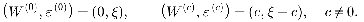
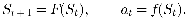
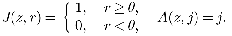
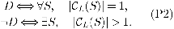
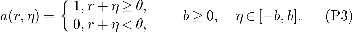
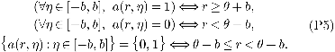
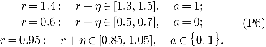

## 第一章：我们究竟在争论什么

我们不妨设想只能感知平面世界的二维生物。当一个三维球体穿过它所在的平面，它只会看见一个圆凭空出现、慢慢变大，再逐渐缩小消失。它们可以从这些观测结果里总结规律，并且和其他二维观察者形成共识。而在三维观察者眼中，这一连串变化，不过是球体穿过平面时显现出的截面。把零散的局部观测经验放到一个更完整的框架里理解，是解读量子现象的一种思路。曼苏里等人（2013，第 4—10 页）在《量子客体》中提出，量子对象是在时间中延展、带有时间组分的四维整体，并用二维生物观察三维物体截面这个类比，来说明我们的观测体验。按照这个观点，薛定谔之猫的生死叠加，是对同一个四维整体的完整描述；而我们在单次测量里得到的确定结果，只是这个整体上的某一个截面。

人的认知会受观测范围和理解能力制约，我们所能感知到的，往往只是一个更宏大完整结构的片段。可如果讨论每个问题时，都不停追问背后有没有更高维度或是别的未知因素，讨论就会不断新增前提，很难得到一个最终结论。所以在比较不同解释之前，先要厘清我们依据哪些记录、采用什么假设、在什么条件下做出判断。科学研究也是同理：在清晰的观测条件与理论假设之下，依靠现有证据解释现象。客观规律本身不依赖人的研究而存在，但我们对规律的认识，要经过提问、建模、实验、反复修改才慢慢成型；研究者也会在这一过程中，创新出全新的理论表述、研究工具与科学方法。

另外，Anderson（1972）指出，理解复杂的整体系统，需要用到与之层级匹配的概念和解释方式。据此，本文以决定论作为预设，探究人的判断与自我调整会如何作用于行动，以及为什么这项能力归属于人自身。

### 1.1 问题、定义与研究范围

决定论（determinism）认为，世界在某一时刻的完整状态与自然规律，共同决定了此后发生的一切。只要这两项条件完全相同，未来就只有一种可能，人的思考与决定也不例外。

自由意志（free will）通常指人能够自主地作出选择，并控制自己的行动。争论的焦点在于：这种自主需要满足哪些条件，以及它能否与决定论共存。

设想一名被告在法庭上为自己辩护：“我的行为完全是由基因、成长经历和当时的环境决定的。我没有自由意志，所以你们无权惩罚我。”在他看来，那些促成犯罪的条件，他从来没有选择过，因此他不该受罚。控方也可以借用决定论来回应：“如果过去和自然规律决定了一切，那么我们审判你、惩罚你，也同样有确定的前因。”

双方都援引了决定论，却各自跳过了一个需要解释的环节。被告的辩护包含三条前提：第一，过去的全部条件和自然规律决定了犯罪的发生；第二，被决定的行动是不自由的；第三，只有当一个人的行为出于自由选择时，处罚他才可能是正当的。这三条分别关乎三个问题：世界如何运行，自由需要什么条件，处罚需要什么根据。决定论本身主张的是第一条。被告如果想据此免责，还必须说明两点：为什么行为被决定就意味着不自由，以及为什么这种不自由足以让对他的处罚失去正当依据。

控方的回应同样没有解决问题。“处罚也被决定”说明的是，接受决定论之后，审判和处罚仍然可以照常进行，却没有说明这些处罚为什么正当。即使某项处罚能够防止犯罪，也不能仅凭这个效果认定它公正；况且，处罚是否有效，本身就无法从决定论中推出来。

先看被告关于自由的前提，即第二条。人无法选择出生时的处境，但长大后可能会重新审视从家庭、教育和生活中接受的观念，改变自己的判断方式，从而参与塑造后来的自己。然而，这些反思本身也可能由过去决定，因此，仅凭“改变了自己”这一点，还不足以证明他是自由的。我们还需要说明两点：行动者在这个过程中究竟能控制什么，以及这种控制为什么足以构成自由。

至于这种自我改变依据什么标准，Galen Strawson（1994）在讨论“终极责任”时指出：一个人要真正应得道德责备，就必须对推动自己行动的性格、动机和判断方式负责。即使他后来经过反思改变了自己，反思时也要依据某些标准；如果这些标准也必须由他自己自由选定，那就还得追问，他选定这些标准时又依据了什么。

本文借此检验：自由是否要求一个人最终创造出自己全部的判断依据。另外，Strawson 讨论的是以道德应得为基础的终极责任，他的结论不能直接套用到所有形式的自由和责任上。同时，被告提到的成长经历与环境，也关系到自主能力的形成：贫困、创伤、成瘾或操纵可能削弱人的理解、反思和执行能力，制度设计与资源分配也会影响人获得和运用这些能力的机会。

### 1.2 为什么从决定论出发

如果决定论 *D* 成立，人的思考和选择也都有确定的前因。[van Inwagen（1975）](https://andrewmbailey.com/pvi/Incompatibility_of_Free_Will_and_Determinism.pdf)认为，在这种情况下，人无法采取不同于实际所做的行动。他的理由是：我们无法改变自己出生以前的世界，也无法改变物理规律；如果过去的条件与规律已经决定了今天的行动，那么，要采取另一种行动，就必须能够使既定的过去或某条规律不再成立。因此，在他看来，即使经过冷静思考、没有受到胁迫，也不具备他所讨论的自由。

从决定论出发，是为了直接检验“行动被决定，所以行动不自由”这一推论。例如，小林对比了两班车的时间后，选了早班车。即使整个思考和决定过程都由过去决定，他权衡之后形成的判断，仍可能是他选择早班车的原因。

上述讨论以决定论成立为前提，而这一前提本身也存在争议。[Potter 等人（2026）](https://doi.org/10.1007/s11229-026-05455-7)指出，自由意志讨论长期围绕“假如决定论成立”展开，并质疑这种讨论框架是否符合现代物理学提供的证据。

### 1.3 真理与证据

要评估这类围绕决定论前提的经验争议，首先需要区分真理与证据。要判断决定论是否符合现实，需要区分一个说法是否为真，以及我们有什么理由相信它。本文把符合事实的说法称为真，把支持判断的观察、记录和实验结果称为证据。例如，一个模型连续几次准确预测了人的选择，可以说明它在相应条件下具有预测能力，却不足以证明所有人的行为，乃至整个宇宙的未来，都已被过去唯一确定。假如只要求模型符合一段有限的观测记录，而没有预先限定全部规律，就可以构造两个模型：一个按确定规则重现记录，并继续唯一演化；另一个在已观测阶段给出同样结果，却在记录结束后允许不同的延续。这段记录不足以排除其中任何一个，但两者的简洁性、解释力和其他证据仍可供比较。反过来，一次预测失败，也可能来自记录不全、测量误差或模型遗漏，不能直接据此否定决定论。正因有限的经验预测无法直接裁定世界究竟是否严格确定，我们更有必要先在概念上厘清决定论的精确含义，排除常见误解。

### 1.4 决定论、宿命论与预先安排

判断预测是否支持决定论，需要先说清“条件相同”指什么。这里要求某一时刻的完整状态相同，不能只看几个可观测条件是否相似。因此，两个成长环境相近的人作出不同选择，并不能直接反驳决定论，因为他们的记忆、身体状况和当时接收到的信息仍可能不同。

决定论并不否认行动能改变结果。比如，复习、睡眠和答题方式即使各有确定前因，仍然可以影响考试成绩。宿命论则认为，无论人怎么行动，某个既定结局都会发生。因此，从“努力本身也由过去决定”，不能直接推出“努力与否都一样”。

决定论也不要求有人在背后提前安排一切。过去与规律能否确定未来，与是否有人出于某种目的设置条件或规则，是两项不同的判断。

行动有原因，也不等于行动受到外在约束。休谟在《人类理解研究》第八节指出，人的动机、性格和处境与行动存在规律性的联系，我们也据此预期他人的行为。同时，他把自由理解为能够按照自己的意愿行动或不行动，例如想走动时能够走动，而非受到囚禁或束缚。在这一理解下，动机与行动之间的因果联系，并不妨碍按意愿行动的自由（[Hume, 1748](https://davidhume.org/texts/e/8)）。

用 *L* 表示自然规律，从模型所考虑的完整状态中任选一个，记为 *S*。在规律 *L* 下，从 *S* 出发的每一种完整演化过程称为一条后续历史。所有这样的后续历史组成集合 𝒞*L*(*S*)，其中历史的条数记为 \|𝒞*L*(*S*)\|。

先要求模型所考虑的每个完整状态 *S* 至少有一条后续历史，即 \|𝒞*L*(*S*)\| ≥ 1。决定论 *D* 进一步要求，每个完整状态恰好只有一条后续历史：

[van Inwagen（1975）](https://andrewmbailey.com/pvi/Incompatibility_of_Free_Will_and_Determinism.pdf)提醒，定义当前状态时，不应把未来结果也写进去。例如，先把“这个人十秒后一定举手”规定为当前状态的一部分，再据此宣布未来唯一，就是把结论写进了前提。

不同理论对“条件相同”的要求也不一样。[List（2014）](https://personal.lse.ac.uk/list/PDF-files/Freewill.pdf)指出，相同的信念、目标和宏观环境，可以对应不同的完整物理状态。即使每个物理状态都只对应一种未来，这些不同状态仍可能导向不同的行动。他讨论的“能够另选”，固定的是心理与宏观条件，并未要求全部物理细节也保持不变。

### 1.5 非决定性与概率

决定论要求每个完整状态在相同规律下只有一种未来，其否定记作 ¬ *D*。沿用上一节“每个完整状态至少有一条后续历史”的前提，非决定性意味着至少有一个状态允许多条后续历史：

规律允许多个未来，并不意味着它已经为这些未来分配概率；即使只有两种可能，也不意味着两者各有一半机会。在 [Norton（2008）](https://sites.pitt.edu/~jdnorton/papers/DomePSA2006_final.pdf)的穹顶模型中，一个起初静止于顶点的质点，既可以始终不动，也可以在某个时刻开始滑动；这些运动都符合模型中的牛顿方程，方程却没有为它们分配概率。

### 1.6 决定与随机是否穷尽全部可能

未来不唯一是否就算“随机”，取决于这里怎样使用“随机”一词。在同一讨论范围内，未来要么被完整条件与自然规律唯一确定，要么没有被唯一确定。

如果把一切非决定性都称为“随机”，世界确实可以按这个定义分成“决定的”和“随机的”。但这项定义没有说明各种结果的概率，也没有说明行动者能否控制选择。自由意志论设想的自主选择，只要未被过去唯一确定，也会被归入这种广义的“随机”，但这不意味着选择纯粹出于偶然、不由本人掌握。

如果“随机”专指按某种概率机制产生结果，那么未来有多种可能，还不足以说明这些结果按什么概率发生。反过来，模型里用到了概率或随机变量，也不说明世界本身就是非决定性的。随机变量用数值表示结果，本身并不规定这些结果在现实中怎样产生（[Pishro-Nik, 2014，第 3.1.1 节](https://www.probabilitycourse.com/chapter3/3_1_1_random_variables.php)）。例如，盒子里的号码卡早已由人指定并封好，我们仍可以用随机变量描述查看之前的不确定性。按数学定义，随机变量甚至可以始终取同一个值。

按概率发生是否排斥主体控制，则是另一个问题。[O'Connor（2009）](https://toconnor.org/wp-content/uploads/2018/07/OConnor_Agent-Causal-Power-2009.pdf)提出，理由可以改变行动者形成某种意向的概率，而具体形成哪一种意向，由行动者本人促成。自由无须成为决定论与非决定性之外的第三种状态。

### 1.7 自由的两种要求与来源问题

选择若已由完整的过去与自然规律唯一确定，是否仍能算自由？ 对此，一种严格的理解将“我本来能选别的”界定为：即使选择前的完整过去与自然规律保持不变，行动者仍能自主选择另一种行动。本文用 *FL* 表示这项自由意志论标准，按这一标准，自由与决定论不能同时成立。

相容论认为，即使行动有确定的前因，人仍可能通过自己的判断作主。本文用 *FC* 表示所讨论的相容论自由标准：一个人能够理解和回应理由、反思自己的想法，并据此行动，且这些能力由本人掌握。

前面两种自由标准都要求行动者能够作主。设想小林脑中有一台装置。它已经植入“走左边”的念头，并会在小林试图怀疑或拒绝时强制消除他的反对。小林真心想走左边，也确实按照这个想法行动。按照 *FL* 标准，他无法自主选择另一条路；按照 *FC* 标准，他审查和修正想法的能力已被装置接管。

判断怎样指导行动，属于实际过程控制的问题；判断能力怎样形成、本人能否审查和修正自己的想法，则涉及来源自主性。本文重点考察形成与检验的历史：一个人学习、检验和修正判断的过程是否被外力架空，以及他能否在反思中逐步调整自己的动机与判断标准。

### 1.8 选择、后果与自由的关系

给定同一种自由标准，以 *F* 表示相应的自由命题，可列出它与决定论 *D* 的四种真假组合：

$$
D∧F,\ D∧¬F,\ ¬D∧F,\ ¬D∧¬F.
$$

本文关心的是第一项 *D* ∧ *F*：在决定论成立的情况下，人是否仍能自由行动。要回答这个问题，先看选择本身被确定，与选择之后的后果被确定，有什么区别。

用 *S* 表示选择前的完整状态，*U* 表示作出的选择。给定 *S* 和 *U*，确定规则 *h* 给出唯一后果 *Y* \= *h*(*S*, *U*)。若先假定 *U* 是 *FL* 意义上的自由选择，再假定选择之后的过程按确定规则展开，就构成“自由选择之后的确定演化”。

接下来，把选择本身也纳入确定过程。若对模型所考虑的每个状态 *S*，有且仅有一个选择 *U* 与之对应，用函数 *g* 表示这一对应关系，则：

$$
U=g(S),\ Y=h(S,g(S)).
$$

此时，给定 *S*，选择 *U* 与后果 *Y* 都被唯一确定，这一模型不满足 *FL*。本文接下来检验，这一确定过程能否满足 *FC*：行动者能否通过自己的理解、判断和反思作主。具体而言，第二章将在决定论模型中论证判断如何实质性地引导行动，第三章将进一步阐明有确定前因的反思机制为何足以构成自由并划清自主的边界，第四章则把视角推进到非决定性与复杂动态环境，检验理性审议与持续校准如何维系控制，最后由第五章总结全书所支持的现实行动自由。

## 第二章：决定论下，人仍能通过判断控制行动

一种疑虑是，思考既然也由过去决定，人就无法控制自己的行动，因此没有自由意志。本章通过确定模型，考察理由怎样形成判断，判断怎样进入执行，行动反馈又怎样影响后续判断。预测、相互回应与待命干预的案例，分别考察这些环节在不同条件下怎样发挥作用。脑活动研究进一步检验其中的信息接收与动作调节环节。

### 2.1 单凭预测残差无法识别自由意志

设想系统根据小林已有的消费记录，预测他今天在咖啡店花 20 元，实际却花了 30 元。系统只保存了消费总额，没有记录商品和价格明细。多出来的 10 元，能否说明小林通过自主选择增加了支出？

即使知道他的真实消费基线是 22 元，扣除 2 元的预测偏差后，剩下的 8 元仍有不同解释：一种情况下，小林没有额外加购，8 元全部来自未记录的附加收费；另一种情况下，他决定加购 3 元的点心，其余 5 元来自附加收费。两种情况都能产生 30 元的总支出。

在行为遗传学中，[Turkheimer（2011，第 827 页）](https://uva.theopenscholar.com/files/eric-turkheimer/files/genetics_and_human_8.pdf)曾提出，将遗传与家庭共有环境之外的行为变异作为衡量人的自主程度的起点。[Morris（2025，第 3.2 节）](https://doi.org/10.1017/thg.2025.22)对此提出批评，指出剩余变异还可能包含测量误差、未测量的环境影响和随机发育差异。

用 *a* 表示行为的数值，*G* 表示基因条件，*E* 表示已记录的环境条件，*W* 表示假定的自由意志因素（允许其贡献为零）；*ε* 表示其余未单独区分的影响，用随机项描述，以反映我们对未记录条件的不确定性。用 *f* 表示这些因素共同产生行为的函数，*f̂* 表示根据已记录条件建立的预测函数，*R*res 表示实际行为减去预测值所得的残差，即 *R*res \= *a* − *f̂*(*G*, *E*)。比较不同情形时，固定 *G*、*E* 和同一个预测函数 *f̂*：

*a* \= *f*(*G*, *E*, *W*, *ε*)   **(2.1)**

先看一个加法模型，将各项都按行为 *a* 的同一单位计量。用 *g*(*G*, *E*) 表示固定 *G*、*E* 后的行为基线，用 *ξ* \= *W* \+ *ε* 表示两项额外影响的总和，则 *a* \= *g*(*G*, *E*) \+ *ξ*。将这一关系代入残差定义，得到：

*R*res \= *g*(*G*, *E*) − *f̂*(*G*, *E*) \+ *ξ*   **(2.2)**

即使知道真实基线，从残差中扣掉它与预测值的偏差后，得到的仍是两项之和 *ξ*。在加法模型中，给 *W* 加上一个常数，同时从 *ε* 中减去同一个常数，两项的总和就保持不变[（Stringer, 2024，第 2.1 节）](https://onlinelibrary.wiley.com/doi/full/10.1002/cjs.11786)。在这个反例中，设 *W* 可以取 0 或某个非零实数 *c*，*ε* 可以取任意实数，用上标 (0) 和 (*c*) 区分这两种情形。对任意给定的 *ξ*，下面两种拆分都成立：

无论 *ξ* 服从什么概率分布，都可以按上述两种方式分别定义 *W* 和 *ε*。两种拆分保留同一个总和 *ξ*，对它的每个取值都得到相同的行为与残差，因此观测分布也相同。这种“观测等价”意味着，仅凭这些分布，无法确定 *W* 贡献了多少[（Rothenberg, 1971，第 578 页）](https://pages.stern.nyu.edu/~dbackus/Identification/id/Rothenberg_id_Econometrica_71.pdf)。

回到式 （2.1） 的一般函数 *f*，用 *ε*0、*εc* 分别表示两种情形中的其余影响。只要模型允许两组输入满足 *f*(*G*, *E*, 0, *ε*0) \= *f*(*G*, *E*, *c*, *εc*)（*c* ≠ 0），不同的 *W* 就会产生相同的行为与残差。这一不可分辨条件也适用于非线性函数，前面的加法反例给出了满足它的具体构造。

在这两种情形中，行为、残差、已知条件和预测函数完全相同，关于 *W* 是否为零的正确判断却相反。任何仅仅依据这些信息的方法，都无法保证在两种情形中判断正确。因此，在包含这类反例、又缺乏额外约束的模型范围内，单凭预测残差无法普遍识别 *W*，也无法确定其贡献大小。

### 2.2 判断可以在确定过程中影响行动

设想小林按天气预报决定是否带伞：降雨概率达到 60% 就带伞，低于 60% 就不带。按这条标准，看到 20% 的预报，他判断不必带伞，空手出门；看到 80% 的预报，他判断需要带伞，拿起了伞。

几次出门后，小林觉得随身带伞比原先预想的更不方便。重新权衡淋雨风险和携带负担后，他把门槛提高到 80%。再看到 70% 的预报时，他就不带伞了。

*再设想另一种情形：一个隐藏装置直接控制小林的手拿起伞，随后才让他产生“今天应该带伞”的念头。即使随后产生的是“不想带伞”，只要装置仍发出同一指令，拿伞的动作也会发生。*

先把人和周围环境放在一起考虑。用 *S* 表示完整状态，*t* 表示从零开始的离散步数，*St* 表示第 *t* 步的状态，*S0* 表示初态。用 *F* 表示状态更新函数，每个允许状态有且仅有一个下一状态，更新后仍在模型允许的范围内；用 *at* 表示第 *t* 步的行动，*f* 表示从完整状态得到行动的函数。本节将 *F* 与 *f* 设为固定的确定函数：

给定初态和固定规则，后续状态与行动便唯一确定。同一个函数 *f* 可以根据不同状态给出不同行动，确定的过程因而可以包含不断变化的判断与反思。

每一步对应一轮判断与行动，用 *zt* 表示当时的信念、记忆、目标和修正规则，*rt* 表示本轮收到的理由信息，*jt* 表示形成的判断，*at* 表示行动，*et* 表示行动后的反馈。再用 *J* 表示形成判断的过程，*A* 表示执行过程，*U* 表示依据理由和反馈修订信念或规则的更新函数：

完整状态 *St* 包含人的内部状态 *zt* 和外部环境状态。这里把判断、执行和更新函数 *J*、*A*、*U* 设为固定的确定函数，理由信息的产生、行动后的反馈和环境变化也都服从确定规则。这些过程共同构成整体更新规则 *F*，决定下一步的完整状态。由 *St* 确定 *zt* 和 *rt*，再把判断结果代入执行函数，便得到 *f*(*St*) \= *A*(*zt*, *J*(*zt*, *rt*))。

在下面这个按判断执行的简单模型中，可以通过改变理由、观察判断与动作怎样随之变化，检验判断的作用。比较同一轮的两种情形，暂时省略时间下标。用 *r* 表示理由信息的数值，*θ* 表示判断门槛，*a* \= 1 表示采取行动，*a* \= 0 表示不采取行动。保持人的内部状态 *z* 和门槛 *θ* 不变，让行动按判断执行：

规则与阈值保持不变；当理由数值跨过阈值时，判断随之改变，并通过执行过程改变行动。

再看装置接管的情形：原来的执行过程 *A*(*z*, *j*) 被替代，只要指令不变，事后形成什么判断都不改变动作。装置也能随指令改变动作，但这种变化绕过了本人的判断。可见，动作能够回应输入，仍不足以说明判断起了作用。前一种模型中，理由可以通过判断影响行动，经验反馈也可以修订后续判断的标准；这些作用都可以发生在确定过程中。

### 2.3 预测选择不等于替人决定

设想有一位观察者，掌握此刻世界的完整状态与自然规律，并有足够的能力在事件发生前完成所需计算。如果世界按确定规律演化，它就能据此推演未来。拉普拉斯设想的这种理想智慧，后来被称为“拉普拉斯妖”（[Laplace, 1902，第 3—5 页](https://www.gutenberg.org/files/58881/58881-h/58881-h.htm)）。

千里之外的一只蝴蝶扇动翅膀，微小的气流变化经过一连串影响，最终可能影响这里一场大风暴的形成。这是“蝴蝶效应”的直观图景：初始条件的微小差异，可能在后续演化中造成显著差别（[Lorenz, 1972](https://wind.mit.edu/~emanuel/Lorenz/EdLorenz/Butterfly_1972.pdf)）。理想观察者可以将这些差异纳入计算；现实中的测量误差却可能在推演中放大，限制长期精确预报。第 1.5 节的穹顶模型则允许同一初态对应多种未来，这种不唯一性也无法靠增加算力消除（[Norton, 2008](https://sites.pitt.edu/~jdnorton/papers/DomePSA2006_final.pdf)）。

#### 2.3.1 预测可以包含本人的判断过程

*观察者提前算出小林中午会选面条，却没有把预测告诉他。到了中午，小林比较口味和饱腹感，选择了面条。提前算出他的选择，是否就意味着替他作了决定？*

在决定论假设下，小林理解理由、作出判断并执行决定的过程，也都有确定的前因。预测者若能算准这次选择，可以将他的思考过程一并纳入计算。提前知道判断的结果，并没有绕过或替代判断。反过来，即使身体动作被外部装置接管，观察者也可能算准。两种情形都可能被准确预测，产生动作的过程却不同：一种通过小林的判断，另一种通过装置的指令。

若采用本文的 *FL* 标准，同一完整过去与自然规律下仍允许行动者自主作出不同选择 *a*1 ≠ *a*2。用 *S* 表示选择前的完整状态，*L* 表示自然规律；仅依据 (*S*, *L*) 运作的预测器面对相同输入只能给出单一结果，因此无法保证在所有允许的延续中都预测正确。

#### 2.3.2 公开预告可能因反向回应而失准

*回到确定的情形。设想有一台自动开关，预测者先在屏幕上显示它稍后将停在“0”还是“1”。开关随后读取预告，严格执行相反的结果：预告为“0”就停在“1”，预告为“1”就停在“0”。预测者知道这条程序，还能让屏幕上的预告与开关最终的状态一致吗？*

沿用可预测性悖论中的反向响应设定（[Rummens 与 Cuypers, 2010，第 2—3 节](https://doi.org/10.1007/s10670-009-9199-1)），用 *p* 表示屏幕上提前公布的预告，*a* 表示开关最终的状态。反向规则与准确预告的要求合在一起，得到：

此时，0 和 1 都无法满足这个方程。因此，只要开关读取预告并严格执行反向规则，公开预告就必然失准。[Wolpert（2008）](https://doi.org/10.1016/j.physd.2008.03.040)从更一般的推断装置框架论证了预测能力的限制。

预测者仍可以算准开关的动作，但须区分内部答案 *q* 与公开预告 *p*。在包含预测者、开关和显示程序的确定系统中，显示程序先定好 *p*；预测者在开关动作前按反向规则算出 *q*，但不把 *q* 告诉开关，也不根据它更改原定预告 *p*。于是：

例如，显示程序准备公布 *p* \= 0，预测者便算出 *q* \= 1，开关随后也停在 *a* \= 1。内部答案正确，公开预告错误，三个数都由初始条件和程序唯一确定。若改为公布 1，开关就停在 0，原先的内部答案随之失效。

预测者可以把行动者的判断过程纳入计算；公开预告还可能成为行动者据以判断的新信息。当双方互相预测时，各自的判断与行动又会成为对方下一步回应的依据。

### 2.4 相互预测中的判断仍可影响行动

上一节以一个行动者的选择为中心，讨论预测怎样进入他的判断与行动。进一步看，如果两个行动者都根据对彼此的预测调整选择，各自的判断又会怎样影响双方的行动？ 这里借用博弈论分析策略与收益的思路（[Nash, 1950](https://doi.org/10.1073/pnas.36.1.48)），通过一个简化的重复猜币模型考察这一过程。

甲乙每轮各出 0 或 1，甲希望两者相同，乙希望不同。用 *t* 表示从 0 开始的轮次，*at*、*bt* 分别表示甲乙第 *t* 轮的选择。先给双方各定一条规则：都把对方上一轮的动作当作本轮预测，甲按预测选择相同的数，乙按预测选择相反的数。双方同时根据上一轮的信息行动，于是：

如果开始时两人都出 0，随后双方的选择依次为 (0, 1)、(1, 1)、(1, 0)，再回到 (0, 0)。规则固定，行动仍随彼此的回应而变化。只看其中一轮，两人相同时，乙改选就能获胜；两人不同时，甲改选就能获胜。因此，没有一种动作组合能让双方都无法通过单独改选提高收益，即不存在纯策略均衡。前面的确定规则仍然可以逐轮产生实际动作。

### 2.5 从三体运动到确定反馈中的混沌

上一节说明，判断与行动可以在固定规则下不断变化；当相互作用更加复杂时，微小差异还可能经由反馈逐级放大。在经典引力模型中，物理三体运动就展现了这种情形：在无碰撞的演化时段内，给定质量、初始位置和速度，运动方程确定唯一轨迹；同样的规律既允许规则的周期轨道（[Chenciner 与 Montgomery, 2000](https://doi.org/10.2307/2661357)），也允许某些构型中的混沌演化，使有限精度的长期预测受到限制（[Stone 与 Leigh, 2019](https://doi.org/10.1038/s41586-019-1833-8)）。类似地，当多个行动者按固定规则相互回应时，判断形成的微小差异是否也会经由反馈放大，而整套过程仍保持确定性？

设 *n* ≥ 2 名玩家参与一项重复的定时协调任务，*i* 表示玩家编号，*t* 表示从 0 开始的轮次。固定共同的周期起点，每轮周期长度记为 1，用 *ai*, *t* ∈ \[0, 1\) 表示玩家 *i* 在第 *t* 轮选择的行动时点；周期首尾相接，时点到达或超过 1 时，只取小数部分。

玩家理解并遵循一条共同约定：观察其他人的行动时点，把这些时点相加，取小数部分作为自己下一轮应当行动的时点。用 *ji*, *t* 表示他据此形成的判断，frac 表示只取小数部分；所有玩家同时更新，并按各自判断执行：

在这套规则下，如果只有两人，双方每轮只是互相交换行动时点，最多两轮就会回到原样，差异不会扩大。到了三人（记为甲、乙、丙，第 *t* 轮的行动时点简记为 *at* \= *a*1, *t*、*bt* \= *a*2, *t*、*ct* \= *a*3, *t*），每人下一轮都要把另外两人的时点加起来取小数：

沿式 （2.8），可以直接看一次判断改动怎样在三人之间传开：假设首轮只有甲因判断不同而调整了 *ε*，乙、丙保持不变。只要这点调整没有改变各次求和的整数部分，乙、丙看到后，下一轮便会依据各自的判断跟着调整 *ε*；再下一轮，甲同时看到两人的变化，判断和行动就会跟着改变 2*ε*。

逐个追踪每个人的后续变化会很繁琐，要看这种互相回应在多轮之后会不会持续放大差异，可以直接观察所有人行动时点之和的变化。用 *st* 表示这个总和的小数部分。推广到 *n* 人时，按式 （2.7），每个人的行动都会被其余 *n* − 1 人各计入一次，因此：

三名玩家时，式 （2.9） 变为每轮翻倍再取小数：*st*\+1 \= frac(2*st*)。把初始值 *s*0 写成二进制小数，每更新一轮，小数点后的第一位数字就被去掉，后面的数字整体向前移一位（[Boghosian 等人, 2019](https://doi.org/10.1002/adts.201900125)）。例如，两个初始值只有小数点后第 10 位不同，其余各位相同，它们起初相差 2−10；更新 9 轮后，这一差异移到第一位，两者相差 1/2。

这不只是单次误差放大的巧合：三名玩家时，无论初始区间多窄，只要宽度大于零，区间内所有初值经过足够多轮更新，它们在同一轮的可能取值就能覆盖 \[0, 1)。推广到任意 *n* ≥ 3 名玩家时，*st* 每轮放大 *n* − 1 倍再取小数，也有同样的效果。任意小的初始范围内都能找到随后明显分离的轨迹（李雅普诺夫指数为 *λ* \= ln(*n* − 1\) \> 0）。*st* 的变化由固定规则确定，却对初始细节高度敏感，同时仍有周期轨道。这一结果依赖“把其他人的行动时点直接相加，而不取平均”的具体规则。

作为对照，让三人各自取另外两人行动时点的平均值，不再取小数部分。设三人的平均值为 *m* \= (*at* \+ *bt* \+ *ct*) / 3。更新后均值不变，且 *at*\+1 − *m* \= −(*at* − *m*) / 2，乙、丙同理。每个人与平均值的差距每轮都缩小一半，三人的行动时点便逐轮靠拢。求和与取平均产生了不同的长期走势；在两套规则中，玩家都依据他人的行动形成判断，并按判断调整下一轮行动。

### 2.6 Newcomb：先被预测，再作选择

上一节讨论了确定反馈怎样使长期预测变得困难。但如果预测者已经提前猜准了行动者的选择，行动者自己的判断还起什么作用？

在 Newcomb 问题中，桌上摆着两个盒子：透明盒固定装着一千美元，不透明盒里可能装着一百万美元，也可能是空的（[Nozick, 1969](https://pdf.stafforini.com/nozick-1969-newcomb-problem-two.pdf)）。预测者先按自己的判断装盒：预测行动者只拿不透明盒，就放入百万；预测行动者拿两盒，就让不透明盒空着。钱放好后，行动者再决定只拿不透明盒，还是两盒一起拿。用 *U* 表示行动者的拿盒选择，*G* 表示不透明盒的装盒状态，各种组合的收益如下：

| 不透明盒的状态 | 只拿一盒：*U* \= 1 | 拿两盒：*U* \= 0 |
| :---- | :---- | :---- |
| 装有百万：*G* \= 1 | 1,000,000 美元 | 1,001,000 美元 |
| 空盒：*G* \= 0 | 0 美元 | 1,000 美元 |

如果盒子已经装好、不再变化，多拿透明盒始终会多得一千元美元。但如果预测者在“一盒组”和“两盒组”中的准确率均为 99%，按最终选择分别统计平均收益，一盒组为 990,000 美元，两盒组为 11,000 美元。这两种计算并不矛盾：前者在盒子状态 *G* 已定的前提下，比较不同选择 *U* 的收益差（[Lewis, 1979](https://gwern.net/doc/statistics/decision/1979-lewis.pdf)）；后者按最终选择分组，比较各组的平均收益，两组中装有百万的比例本就不同（[Wolpert & Benford, 2010](https://arxiv.org/abs/0904.2540)）。

在一种按固定规则运行的解释中，预测者根据掌握的部分既有信息 *z*，提前估计行动者会怎样权衡理由，并据此装盒（*z* → *G*）。行动者则结合既有条件与当下考虑的理由 *r*，形成判断 *j*，再按判断拿盒（(*z*, *r*) → *j* → *U*）。

盒内状态 *G* 已定，行动者也仍照判断拿盒；此时可以比较他接触不同理由 *r* 的情形。如果新理由让判断 *j* 从“拿两盒”变为“只拿一盒”，选择 *U* 也会随之改变。预测者只是提前估计了这段思考，并没有替行动者作出决定，行动者实际仍通过权衡和判断作出选择。

### 2.7 Frankfurt：待命干预与实际路径

上一节中，预测者先按预测装好盒子，行动者随后再作选择。如果还有人准备在必要时强行改变他的选择，本人的判断还起作用吗？ Frankfurt（1969）设想，Black 希望 Jones 作出某个特定选择，准备在 Jones 将要偏离目标时介入。实际这一回，Jones 权衡自己的理由、形成判断，并据此作出选择；Black 始终处于待命状态。Frankfurt 用这个例子挑战“只有本来能做别的选择，才谈得上道德责任”的传统看法，并将讨论转向本人的理由与判断怎样产生实际行动（[Frankfurt, 1969](https://personal.lse.ac.uk/ROBERT49/teaching/ph103/pdf/Frankfurt1969.pdf)）。

按照案例的设定，Jones 若因新的理由准备改选，Black 会介入并确保目标选择。这样的结果由干预促成；实际这一回，选择则由 Jones 自己的理由和判断产生。结果相同，两种情形中产生结果的过程各有区别：一种是本人判断形成选择，另一种是外部干预改写选择。

Black 要保证及时干预，就得提前识别 Jones 是否会偏离目标。Widerker（1995）指出，这里存在两难：如果提前出现的迹象已经在因果上充分决定了选择，非相容论者就会追问，这样的选择还算不算自由；如果这些迹象仍容许 Jones 改选，Black 就可能继续待命，让另一种选择发生（[Widerker, 1995](https://place.asburyseminary.edu/faithandphilosophy/vol12/iss1/7/)）。在决定论设定下，本文正是在第一种情形中推进论证：即便大脑或心理的早期迹象已经参与决定了随后的选择，只要实际推动行动的是 Jones 本人的理由权衡而非 Black 的强行改写，判断就依然发挥了真实的因果作用——至于这类有确定前因的选择为何仍能算作自由，则留待第三章专门回答。

### 2.8 脑活动怎样参与选择

2.2 节的模型假设选择由本人的理由与判断驱动，而 2.7 节的待命干预讨论则进一步引出了一个实证问题：如果大脑在人意识到意图之前就已经出现动作准备信号，有意识的判断在随后的行动中究竟还起什么作用？

早期神经科学研究确实发现了这类提前出现的信号。Libet 等人让受试者自行决定何时屈动手腕或手指，同时记录脑电；动作结束后，受试者对照旋转光点报出最初意识到自己想动的时刻（记为意识时刻 *tW*）。研究者以肌电测得的动作起点为准，对齐多次脑电记录并求平均后发现，受试者临时起意时，准备电位平均比 *tW* 早约 350 毫秒；事先有所计划时，这一时间差大约为 800 毫秒（[Libet et al., 1983](https://doi.org/10.1093/brain/106.3.623)）。Matsuhashi 与 Hallett 改用随机提示音当场探测受试者是否已经意识到想动，推算出意识出现的时刻平均比实际动作早 1.42 秒，也比事后看钟报出的时刻早得多（[Matsuhashi & Hallett, 2008](https://doi.org/10.1111/j.1460-9568.2008.06525.x)）。在更长的时间尺度上，Soon 等人利用功能磁共振成像（fMRI）监测受试者自主选择按左键或右键的过程，发现早在受试者自报作出选择的时刻之前约 7 秒，前额极的神经活动记录就已能以约六成的准确率预测随后的按键方向；计入血流反应延迟后，相关神经活动甚至可能比自报时刻早约 10 秒（[Soon et al., 2008](https://doi.org/10.1038/nn.2112)）。

然而，后续研究从信号本质、执行可逆性与任务性质三个层面表明，这些提前出现的脑活动并不能证明有意识的判断只是事后旁观。首先，就信号本身的含义而言，Schurger 等人提出的随机累积模型指出，神经活动在不断波动中累积到阈值时才会触发动作；研究者把每次动作发生的时刻对齐，再对动作前的模拟波形求平均，同样能得到一条看似提前爬升的曲线（[Schurger et al., 2012](https://doi.org/10.1073/pnas.1210467109)；[Schurger et al., 2021](https://doi.org/10.1016/j.tics.2021.04.001)）。这意味着，平均准备电位的提前爬升未必代表无意识早已拍板，而可能是随机神经波动跨过动作阈值的统计结果。

其次，就动作执行的控制而言，准备信号出现并不意味着后续过程已经彻底锁死。Schultze-Kraft 等人利用脑电实时预测受试者何时准备用右脚踩键，并在预测信号出现时发出停止提示；结果显示，受试者仍能依据新提示取消动作，阻止动作开始的临界点约在肌电起点前 200 毫秒，甚至超过这一界限后，受试者仍可能中断已经开始的动作，避免完成踩键（[Schultze-Kraft et al., 2016](https://doi.org/10.1073/pnas.1513569112)）。

最后，也是最关键的一点，任意按键实验的结论不能直接推广到需要权衡理由的审慎选择。Maoz 等人对比了两类左右按键任务：一类可以任意选按，按哪边都不影响捐款分配；另一类则需要权衡支持哪家公益组织，并在实验结束后随机抽选兑现真实捐款。结果发现，任意选择的平均脑电波形中出现了典型准备电位，而审慎选择中则未检出同类典型波形（[Maoz et al., 2019](https://doi.org/10.7554/eLife.39787)）。综上可见，脑活动信号既不排除动作准备后的实时调节，也未否定审慎权衡在真实决策中的实质参与。

至此，本章在决定论前提下完成了对“判断控制行动”的系统辩护：单凭行为残差无法识别自由意志（2.1），但形式模型表明，理性的判断、执行与反馈更新完全可以在确定性规则下实质性地引导行动（2.2）；无论是外部预测（2.3）、博弈互动与混沌反馈（2.4—2.6）、待命干预（2.7），还是神经层面的早期信号（2.8），都未架空本人的判断机制。然而，质疑者仍可退后一步追问：即便判断确实左右了眼前的行动，如果人的判断标准和反思方式本身也是由过去决定的，这种自己作主的能力凭什么算得上自由？这正是下一章要解决的核心难题。

## 第三章：有确定前因的选择，为什么仍能算自由

人的判断固然能左右行动，但最初的判断习惯和标准却并不是自己选定的。人如何从既有的条件出发，通过学习和反思去权衡理由、调整想法，进而塑造自己，又凭什么说这种自己作主的能力算得上自由，正是本章要回答的问题。

比如，甲看到不利于原计划的证据后，重新评估目标，并照修订后的判断付诸行动；乙同样看懂了证据、也想改变，动作却完全受控于外部装置。两人差在哪里？一个人要真正掌握自己的判断与行动，必须具备五个层面的能力与条件。

第一，看得清处境与理由。人要能明白证据为何支持某一论断、后果将如何影响目标，也要能察觉眼前的欲望与长远计划之间有什么冲突。

第二，听得进理由并据此调整。看懂的理由不能只停留在嘴上，而要真正进入判断；人会掂量理由的分量，决定维持还是修改原本的想法。

第三，能回头审视自身标准。人不仅能就事论事，还能借助既有的经验与价值观念，反过来检讨自己的部分欲望、目标和评判标准，并作出修正。

第四，能照判断付诸行动。想明白之后，在现实条件允许的范围内，人既能依判断采取行动，也能据此推迟、中止或改变原有的做法。

第五，成长和反思中有检验、修订标准的机会。考察人能否作主，不能只看眼前，还要看这些能力如何养成、又如何保住。在学习和形成动机的过程中，人得有机会接触不同理由、检验既有准则；后来的反思也应能实质地改变旧规矩，而不是一有异议就被外力强行压下或改写判断。即便早年受过这种限制，后来能否重新获得审视与修正的机会，同样要纳入考察。下文将先直面针对“判断来源”的决定论质疑（3.1），再通过动态更新模型阐明有因反思如何运作（3.2），进而逐一回应上述质疑并确立相容论立场（3.3），最后借外部干预与设计反例划清自主的边界（3.4）。

### 3.1 判断能力的来源问题

就算一个人确实经过理解和反思才作出决定，质疑者仍会追问，如果他的思考方式和每一次改主意都由过去决定，为什么还算他自己作主（[Pereboom & McKenna, 2022](https://academic.oup.com/edited-volume/38853/chapter/337828071)）？

假设有人在幕后预先安排好了一个人的初始能力和全部成长经历，却不插手他日后的具体决定。因此，在现实生活中，这个人依然能听懂理由、自主反思，甚至随时修改原本的判断（[Pereboom & McKenna, 2022](https://academic.oup.com/edited-volume/38853/chapter/337828071)）。反对者认为，即便如此，这样被预先“写好剧本”的人显然算不上自由；而既然自然因果对人的塑造，与这种幕后设计在决定方式上并无二致，那么在一般决定论之下，人也同样没有自由可言。

反对者还可进一步追问：用来检验和修订判断的标准，是否也必须由本人更早的自由选择确立？这涉及 Strawson 讨论终极道德责任时提出的回溯问题（[Strawson, 1994](https://doi.org/10.1007/BF00989879)）。

### 3.2 有因的反思与自我形成

*奶奶小时候学过一条规矩：煮汤要放一勺盐。她照着做了几十年。有天换了食材，孙女提醒说，这批原料本身带咸味，再放一勺可能太咸。奶奶先尝了一口，又盛出两小碗比较不同加盐量的味道，发现一律放一勺并不总合适。这次她少放了盐，后来煮汤也开始根据食材和实际味道调整盐量。孙女不在时，她也这样做。对于“一律少放盐”的建议，她仍会尝过汤后再判断。按决定论 D 的设定，她从听懂提醒、尝汤比较到改变做法，每一步都有确定的前因。*

用 *t* \= 0, 1, … 标记前后各轮：第 *t* 轮既有的判断方式记为 *Mt*，这一轮遇到的新经验与理由记为 *Et*。行动者结合新经验检视旧规矩，决定沿用还是修订，从而形成下一轮的判断方式 *Mt*\+1，这一更新过程记为 *U*。到了第 *t*\+1 轮，他便依据新的判断方式 *Mt*\+1 与当下的情况 *Et*\+1 作出判断并付诸行动。这里用 *A* 表示判断与执行的整个过程，这一轮的行动记为 *at*\+1：

即使规则 *U* 与 *A* 本身固定不变，新的经验仍可能通过 *U* 改变判断方式，进而影响后来的行动。*Mt* 已经包含过往教育、尝试与评价的影响，修订后的 *Mt*\+1 又会成为下一轮继续修订的起点。

将 *Mt* 简化为二值规矩 *m*：*m* \= 0 表示一律加一勺，*m* \= 1 表示按已有盐量决定。模型用 *r* 记录奶奶是否理解并接受了修订证据：*r* \= 1 表示本轮接受修订，*r* \= 0 表示本轮未发生这次修订；修订后的 *m*′ 对应 *Mt*\+1。每锅汤的目标总盐量设为 1，下一锅已有盐量 *c* ≥ 0 属于下一轮的情况 *Et*\+1。*j* 是判断应加的盐量，*a* 是实际加盐量，max 表示取两数中较大的一个：

原先 *m* \= 0，本轮 *r* \= 1 时更新为 *m*′ \= 1，下一锅 *c* \= 0.8 时得到 *j* \= *a* \= 0.2；若本轮 *r* \= 0，则保留 *m*′ \= 0，面对同样的已有盐量，得到 *j* \= *a* \= 1。若已修订为 *m*′ \= 1，后续便沿用这条新规矩。再遇到一锅已有盐量为 0.1 的汤，就得到 *j* \= *a* \= 0.9。由此可见，奶奶从早年学来的规矩出发，即便每一步都有确定的前因，她依然能通过理解和尝试改变未来行动。

### 3.3 决定论下的自主权为什么能算自由

奶奶通过尝汤、比较咸淡，重新审视了原来的调味标准，并按新的判断调整做法。本文把这种能审视、修订打算，并落实到行动上的掌握称为自主权。但这些活动都有确定的前因，这样的掌握为什么仍算得上自由？ 反对者首先会质疑，奶奶既没有选择自己的过去，连反思方式也由过去塑造，因此并没有真正掌握自己的决定。然而，若仅凭反思和调整受过去影响，就否认它们算得上奶奶自己作主，这其实已经暗中把“完全独立于过去”当成了作主的前提。

只要人还能凭理由重新考虑打算，并在条件允许时照判断去做，“要不要做”和“怎样去做”的主动权就握在他自己手里。本文将这种掌握视为行动自由的根据。外界的强迫或接管之所以让人不自由，恰恰是因为它们堵死了人反思改主意的余地，或者直接截断了判断对行动的控制。同样关注这种高阶自我把关的，还有 Frankfurt 对“二阶意愿”的讨论，即人会希望某一种欲望真正主导自己的行动（[Frankfurt, 1971](https://www.sci.brooklyn.cuny.edu/~schopra/Persons/Frankfurt.pdf)）。

反对者还可以把追问再往前推一步：促成选择的欲望和标准本身，是不是也得由人更早的自由选择来确立？ 奶奶决定修改食谱时，手里已经得有一套口味偏好和评判标准。如果这套标准也必须出自她更早的自由选择，那上一次选择又凭什么作标准？ 照这个要求一路追问下去，就会陷入无限回溯。Strawson 在讨论终极道德责任时，正是借这一回溯指出，人不可能在核心心理特质上充当自己的最终原因。即便把偶然因素算进来，它本身也同样不能让这些标准变成人自主选择的结果（[Strawson, 1994](https://doi.org/10.1007/BF00989879)）。

在成长和与人相处的过程中，如果不同意见一露头就被压下去，那么就算一个人真心认可自己的想法、也能讲清为什么这么做，他依然很难有机会回头审视原来的标准。Fischer 与 Ravizza 在讨论道德责任时也指出，行动者的决策机制能否真正算作他自己的，离不开他的成长经历（[Fischer & Ravizza, 1998](https://www.homepages.ucl.ac.uk/~uctytho/dfwCompatFischerRavizza.htm)）。可见，决定论本身并不妨碍自我掌控；只要成长与反思的历史条件未遭压制，上述五个层面的能力便能在现实中得以保全。因此，决定论 *D* 与本文所辩护的行动自由 *FC* 可以共存。

### 3.4 外部干预与自主的边界

假设另有装置强行决定奶奶的加盐量。她判断该加 0.2 勺，装置却让她实际加了 1 勺。她仍能尝汤和作判断，却无法按判断加盐。沿用 3.2 的记号，*j* 是奶奶判断应加的盐量，*a* 是实际加盐量。现在加入接管开关 *b*：*b* \= 0 表示未接管，*b* \= 1 表示装置完全接管，*k* 是装置规定的加盐量。在这个简化模型中，装置接管后便按 *k* 加盐，不随奶奶的判断改变：

$$
a=(1-b)j+bk,\ b∈\{0,1\}.
$$

**(C3)**

在式 （C3） 中固定 *b* 与 *k*，用 *a*(*j*) 表示判断为 *j* 时的实际加盐量。设奶奶在两种假设情形中分别作出不同判断 *j*1、*j*2，由式 （C3） 可得：

未被接管（*b* \= 0）时，实际加盐量会随奶奶的判断而变；一旦装置接管（*b* \= 1），加盐量便恒定为 *k*，不再受她判断的影响。正因如此，在装置接管下，即便某次实际加盐量恰好符合她的判断（*j* \= *k*），也不能说明是判断控制了动作。同一确定的执行规则，既可以落实奶奶本人的判断，也可以执行外部装置的指令。

以上考察的是判断对动作的执行控制；外部干预还可能直接作用于判断本身，阻断行动者检验与修订规矩的通道。奶奶早年学会一律加一勺，后来仍能检验和修订这条规矩，也能决定是否继续照办。若装置不控制她的手，而是在她准备少加盐时改写记忆、把判断恢复成一律加一勺，情况就不同了。她可能真诚认可结果，也能说出貌似合理的解释，但她通过尝汤和比较形成的新判断会被强制改回，无法改变后来的做法。同样，单次强行植入的信念也可能造成持续的检验障碍：《黑暗森林》中的受试者真心相信“水有毒”，却难以根据相反理由改变看法（刘慈欣, 2008）。这表明，仅凭当事人主观上真诚认同，并不足以证明他仍具备审查该信念的能力。

若改写记忆的装置停止工作，还要看奶奶能否接触反证、检查旧记忆，并按重新检验后的判断行动。她可能恢复已有能力，也可能直到此时才学会审查和修订。不过，后来的恢复不能倒推证明她在受控期间已经自由，过去的受控经历也不必使她此后的每次选择都失去自由。

3.1 提出的设计者反例还要追问：如果连奶奶后来的反思也属于设计者对整条历史的安排，她是否仍然是在自己作主？ 在这一设定中，设计者并未安插持续否决她评价的装置，因此，整条历史被预先选定，与她实际运用理性能力并不冲突。奶奶仍能理解和评价理由，检验并修订规矩；她既能经比较改判，也能经审查保留原判断，并让判断指导加盐。

前节已将人能审视行动依据、决定是否照办并落实于行动，作为行动自由的根据。借鉴 McKenna 直接质疑“被操纵者必然不自由”这一前提的回应方式（[McKenna, 2008](https://doi.org/10.1111/j.1933-1592.2008.00179.x)；相关争论见 [Pereboom & McKenna, 2022](https://academic.oup.com/edited-volume/38853/chapter/337828071)），只要这些能力及相关历史条件在现实中得以保留，历史出自设计本身不足以否定奶奶的行动自由。至此，我们已在决定论前提下完成了对行动自由 *FC* 的辩护与边界界定；然而，如果现实世界与大脑并不满足严格决定论，这种基于审议与校准的控制能力又该如何成立？这正是下一章要直面的挑战。

## 第四章：Potter 的挑战与非决定性下的控制

前三章在决定论设定下分析了判断的作用、自主能力的条件和操纵的影响。1.2提到的 [Potter 等人（2026）](https://doi.org/10.1007/s11229-026-05455-7)质疑了自由意志讨论中的常见预设，指出既不能先验认定宇宙只有唯一的未来，也不能在承认微观不确定性后，仍断定大脑活动严格确定，或仅受偶发随机事件干扰。他们认为，物理状态本身未必具有无限精度，复杂系统又可能放大微小差异，少数宏观系统的稳定并不足以证明大脑也会消除这些影响。

[Potter 与 Mitchell（2026）](https://doi.org/10.1007/s11229-026-05570-5)的配套论文反对“没有被决定，就只能碰运气”的推论，认为行动者的审议本身参与了决定的形成。如果选择前的完整状态与自然规律仍允许不同结果，人的审议怎样影响行动，又凭什么说行动由本人控制？

### 4.1 从唯一未来到多种允许的延续

沿用1.4—1.5的记号，*S* 表示完整状态，*L* 表示规律，*𝒞L*(*S*) 表示允许的全部后续历史；竖线表示其中历史的条数。仍要求每个允许状态至少有一条后续历史。对照关系为：

如果实际状态精确而观察记录不够精确，一个初态集合表示的是观察者尚不能区分的多个初态；每个具体初态仍对应唯一轨迹。物理上的非决定性则是在同一完整状态与相同规律下，允许不同的实际延续。

即使整体不满足决定论，某次选择仍可能只有一种结果。在一个具体的输入模型中，仍用 *S* 表示选择前的完整状态，将随后参与选择的额外输入记为 *η*，行动记为 *a*，用固定的行动函数 *f* 表示三者的关系：

*a* \= *f*(*S*, *η*)

若 *η* 由 *S* 唯一确定，这一步的行动也唯一确定。若采用离散随机模型，则要另行规定 *η* 的概率。固定 *S* 与规律后，只要 *η* 至少有两个概率大于零的取值，并分别产生不同的行动，这次选择就允许不同结果。例如，按真随机硬币的正反面作出不同回答，人决定了采用掷币办法，具体回答却取决于硬币落在哪一面。

对于需要权衡相反理由的选择，Potter 与 Mitchell 认为，决定是在行动者比较理由、调整权重的过程中形成的。他们把这种审议理解为一种控制：行动者可以引导决定的形成，而不必事先固定每个微观细节（[Potter et al., 2026](https://doi.org/10.1007/s11229-026-05455-7); [Potter & Mitchell, 2026](https://doi.org/10.1007/s11229-026-05570-5)）。

### 4.2 有界影响下的行动阈值

为了刻画理由权衡如何在非决定性波动下引导决定，下面把上一节的行动函数具体设为一条阈值规则。用 *r* 概括选择前状态 *S* 中评估得到的理由强度；用 *θ* 表示采取行动的固定阈值，用 *a*∈{0,1} 表示行动，其中1是采取行动，0是不采取行动。本节沿用 *η* 表示选择过程中的额外输入，并将它具体设为有界实数，用非负数 *b* 表示其绝对值上限。模型允许 *η* 取\[-*b*,*b*\]中的任意值，不另行指定概率分布。再假定将 *η* 与 *r* 相加后同阈值比较：

若 *η* 是未知但固定的量，区间表示尚不能排除的输入；若同一选择前状态允许不同 *η* 实际实现，区间则表示该环节的不同可能输入。给定 *r* 和 *b*，*r*\+*η* 的取值范围为：

$$
r+η∈[r-b,r+b].
$$

(*P*4\)

要使所有允许值都触发行动，最小值也必须达到阈值。于是 *r*\-*b*≥*θ*，等价于 *r*≥*θ*\+*b*。反过来，满足这一条件，区间里的全部值确实都达到阈值，所以这个条件既必要也充分。

要使所有允许值都不触发行动，最大值也必须严格低于阈值。于是 *r*\+*b*\<*θ*，等价于 *r*\<*θ*\-*b*。这里必须保留严格小于：恰好达到阈值时，规则已经输出1。

要使两种行动都可能，区间下端必须低于阈值，上端必须达到阈值。合起来得到 *θ*−*b*≤*r*\<*θ*\+*b*（即 *r*−*b*\<*θ*≤*r*\+*b*）。满足这一条件时，分别取 *η*\=−*b* 与 *η*\=*b*，便能得到0与1。下式第三行用集合列出给定输入区间对应的全部行动结果：

当 *b*\=0 时，第三行中 *r* 的取值区间为空，前两行退回通常的确定阈值规则。

例如，把阈值设为1，影响上限设为0.1，逐项代入可得：

前两行中，*η* 在允许范围内怎样变化，都不会改变输出；不同理由分别稳定地产生行动和不行动。第三行的两种结果来自 *η* 的不同取值，模型没有规定主体怎样选择 *η*。设行动者因新信息重新评估理由，将 *r* 从0.95提高到1.2。影响后的范围变为\[1.1,1.3\]，规则稳定地输出1。可见，即便选择过程存在有界的不确定输入 *η*，只要理由强度远离阈值临界区，行动依然能够保持确定而稳定的输出；而当权衡恰好落在临界区间内时，行动者仍可通过重新审视处境、调整理由权重，将自己带出受微小波动左右的区域。

### 4.3 混沌系统中的误差增长与持续校准

前节在给定状态估计下考察了有界不确定性对行动的影响；然而，导言中 Potter 等人指出的另一重挑战在于，无论是大脑还是外部环境，复杂非线性系统都可能将初始的微小差异逐级放大。当行动者置身于持续变化的环境中时，判断所依赖的状态估计究竟能可靠多久？ [Lorenz（1963）](https://wind.mit.edu/~emanuel/Lorenz/EdLorenz/Deterministic_63.pdf)在确定性的对流模型中展示了初态敏感性，[Stone 与 Leigh（2019）](https://doi.org/10.1038/s41586-019-1833-8)则研究了某些非层级三体构型的混沌散射。这类动力学模型表明，初始估计的微小偏差在混沌时段内可能逐渐放大，从而限制可靠预测的时长。

在适用的混沌演化时段内，可用指数关系近似轨道状态估计误差的增长。用 *δ*(0)\>0 表示初始估计误差的大小，*δ*(*t*) 表示经过时间 *t*≥0 后的估计误差，并以 *λ*\>0 表示这一时段内近似不变的增长率：

设允许的最大误差为 *δ*\*，且 *δ*\*\>*δ*(0)。将误差达到这一上限的估计时间记为 *t*max。令式（P7）中的 *δ*(*t*) 达到 *δ*\*，将两边除以 *δ*(0) 后取自然对数，得到 *λt*max≈ln\[*δ*\*/*δ*(0)\]，因而：

在 *λ* 与容许误差不变时，初始误差越小，这一估计时长越长。新观测若能缩小当前估计误差，就可把更新后的误差作为下一段预测的初始误差，用式（P8）重新估算预测时长。

[Grover 与 Sato（2012）](https://merl.com/publications/docs/TR2012-062.pdf)在平面圆型限制性三体模型中，将新观测用于航天器的轨道估计：他们先按运动方程传播状态的概率分布，再根据间断获得的新观测更新这一分布。这一过程揭示了一个普遍的控制难题：当观测精度、更新频率和计算资源都有限时，系统必须依靠持续的信息反馈与误差修正，才能把估计误差维持在容许范围内。

综合本章的三步分析，我们已经能够正面回应导言中 Potter 等人提出的挑战。即使宇宙与大脑不满足严格决定论、同一当前状态允许不同的后续延续（4.1），非决定性也并不等于盲目碰运气：只要不确定输入是有界的，充分的理由权衡依然能够通过阈值机制稳定地主导行动（4.2）；而面对复杂系统中误差放大的风险，行动者则可以通过持续的观测、反馈与认知校准来维持控制（4.3）。至此，无论在决定论还是非决定论框架下，我们都已阐明了理性审视与执行控制如何成立；下一章将在此基础上，总结全书最终辩护的是一种怎样的行动自由。

### 4.4 尚待完成的研究：操纵、纠错与动态边界

【状态】本节保留原第五章的研究任务，不填入尚未完成的证明。前文公式继续支持原论证；本章新增的阈值演算只按实际推导报告，不据此声称已经得到原创数学定理。

#### 4.4.1 明确要证明的命题

承接3.4，选择一个具体问题；分别说明研究某次行动、持续自主能力，还是能力受损后的恢复。

后续模型需要检验四个描述性问题：新理由能否系统地改变判断；主体能否检查并修订改变判断的规则；修订能否进入行动；另一个机制是否压倒、封闭或伪造了这些环节。

#### 4.4.2 明确模型与干预权限

规定主体能接收、核查和修改什么；规定攻击者能改写信息、判断规则或执行过程到什么程度，以及哪些条件仍可信。

#### 4.4.3 明确成功与失败标准

分别定义检测成功、纠正成功、核查能力保留与恢复；说明时间范围、误差容许值及计算或核查资源。

#### 4.4.4 与已有定理比较

逐项比较已有模型的假设与结论，确认哪些可直接使用、哪些需要修改；只把确实新增的证明列作新结果。

【补充研究线索】Showkatbakhsh等（2019）：受攻击条件下的状态重建。论文研究已知线性时不变系统：在受攻击通道集合固定、数量受限，并满足相应稀疏强可观测性条件时，怎样从受到篡改的输入与观测中重建状态。这里的“重建”指正确估计系统状态，不是修复受攻击系统，也不能直接证明人的判断能力已经恢复。[https\://arxiv.org/html/1904.01869](https://arxiv.org/html/1904.01869)

**【补充研究线索】Kawan**（2019）**：恢复熵与持续估计**

【待补】用途：讨论误差随时间扩大时，持续跟踪需要的信息速率；用于连接三体启发的预测困难与及时核查。

【使用条件】说明动力系统及观测框架；原结果没有直接包含恶意篡改，不能未经推导就把恢复熵当作抗操纵界限。[https\://pmc.ncbi.nlm.nih.gov/articles/PMC7514178/](https://pmc.ncbi.nlm.nih.gov/articles/PMC7514178/)

#### 4.4.5 推导边界与构造反例

尝试给出成功的充分条件与失败的必要限制；能否得到充要条件，待实际研究决定。

#### 4.4.6 动态模型的检验

选择三体或其他动态系统，检查误差随时间扩大时结论是否保持；明确物理模型、抽象模型与人的判断之间的对应范围。

在新的非决定性比较中，上述任务还要说明允许的状态变化和概率假设，并将普通噪声、恶意干预和检查过程被接管分别建模。若要得到比已有研究更强的结论，需要明确新增的假设、命题与证明。

【待整合】保留现有相容论结论；3.4完成后加入自主判据的检验结果，第四章只加入实际完成且已核对的数学结论。结尾不以处罚政策替代自由问题。

## 第五章：我们最终支持怎样的自由

本文最终辩护的，既非脱离因果律的绝对自由意志（*FL*），也非架空现实条件的抽象自主，而是一种扎根于理性审视与执行控制的现实行动自由（*FC*）。全书的核心论证表明，选择拥有确定的过往前因，并不意味着理解、权衡与判断只是因果链条上的冗余旁观。在决定论前提下，行动者依然能够凭借新经验检视并修订既有规矩，使判断实质性地引导后续行动；判定自由的关键，在于本人能否在实际生活中审查行动依据并主导执行，而不在于他是否无中生有地创造了最初的判断标准，也不因历史出自塑造或设计而自动失效。

将视角从确定性模型推向充满不确定性与波动的真实世界，这一立场同样成立。无论面对大脑层面的不确定性（[Potter & Mitchell, 2026](https://doi.org/10.1007/s11229-026-05570-5)），还是动态环境中的误差放大与信息干扰，理性的审议指引与持续的观测校准依然能够维系行动控制。历史经验与当代神经科学也为这些能力提供了现实佐证：从达尔文刻意记录反证、直面理论异议的自我纠偏习惯（[Darwin, 1859](https://darwin-online.org.uk/converted/published/1859_Origin_F373/1859_Origin_F373.html)；[Darwin, 1876–1882](https://darwin-online.org.uk/converted/manuscripts/Darwin_C_R_CUL-DAR26.1-121.html)），到人类在动作准备阶段仍能依据新提示及时调节乃至中止执行的神经机制（[Schultze-Kraft et al., 2016](https://doi.org/10.1073/pnas.1513569112)；[Maoz et al., 2019](https://doi.org/10.7554/eLife.39787)），都印证了人在现实中确实具备审视观念与调节行动的能力。

归根到底，本文所支持的是一种有限、有条件且可能受损的行动自由。它之所以有限，是因为人总是在既有的历史背景、有限的信息精度与特定的神经生理约束下进行权衡，不可能摆脱一切前因而凭空抉择；它之所以可能受损，是因为一旦外部强制、信息封锁或神经机制失调切断了“检验理由—修订判断—主导执行”的链条，自由便会随之削弱乃至丧失。但只要这些核心能力在现实中得以运转，决定论 *D* 的成立便不会剥夺人的自主。承认自由的有限与脆弱，恰恰使我们得以在真实的因果世界里，看清人究竟凭什么为自己的选择负责。

将这一立场推向现实与未来，自由便不再只是一个形而上学的概念之争，而是一项需要持续维护的实践课题。随着神经调控、算法分发与信息操控技术的演进，外部干预对人的判断前提与注意力结构的塑造将愈发隐蔽，这要求我们更加警惕信息封锁与隐性接管，通过透明的信息环境与审慎的公共制度，护住行动者核查证据、独立反思的空间。与此同时，看清自由的有限性，也让我们得以用更公允的尺度看待人类自身：我们既不必因行动受制于过往经历与自然规律而滑向宿命论的消极，也不应以脱离一切因果约束的完美主体标准去苛责他人。

更重要的是，支撑人不断前行并区分人与被动之物的根本力量，正是对事物持续追问、不肯停止思考的能力与渴望。无论宇宙最终是否服从决定论，也不论是否真有看不见的高维存在在观察乃至预设了我们的轨迹，只要人还在感受、权衡、审视既有规则并尝试修订自身，这种永不熄灭的思辨与求知欲，便构成了人类对“被当作既定程序运转”最清醒的回应，也是我们作为主体真切活在世上的证明。

## 参考文献（References）

文献采用作者—年份制，以下统一列出正式出版信息。

Anderson, P. W. (1972). More is different. *Science, 177*(4047), 393–396. [https\://doi.org/10.1126/science.177.4047.393](https://doi.org/10.1126/science.177.4047.393)

Boghosian, B. M., Coveney, P. V., & Wang, H. (2019). A new pathology in the simulation of chaotic dynamical systems on digital computers. *Advanced Theory and Simulations, 2*(12), 1900125\. [https\://doi.org/10.1002/adts.201900125](https://doi.org/10.1002/adts.201900125)

Chenciner, A., & Montgomery, R. (2000). A remarkable periodic solution of the three-body problem in the case of equal masses. *Annals of Mathematics, 152*(3), 881–901. [https\://doi.org/10.2307/2661357](https://doi.org/10.2307/2661357)

Darwin, C. R. (1859). *On the origin of species by means of natural selection, or the preservation of favoured races in the struggle for life*. John Murray. [https\://darwin-online.org.uk/converted/published/1859\_Origin\_F373/1859\_Origin\_F373.html](https://darwin-online.org.uk/converted/published/1859_Origin_F373/1859_Origin_F373.html)

Darwin, C. R. (1876–1882). *Recollections of the development of my mind & character* \[Autobiographical manuscript, CUL-DAR26.1–121\]. Cambridge University Library. Darwin Online. [https\://darwin-online.org.uk/converted/manuscripts/Darwin\_C\_R\_CUL-DAR26.1-121.html](https://darwin-online.org.uk/converted/manuscripts/Darwin_C_R_CUL-DAR26.1-121.html)

Fischer, J. M., & Ravizza, M. (1998). *Responsibility and control: A theory of moral responsibility*. Cambridge University Press. [https\://doi.org/10.1017/CBO9780511814594](https://doi.org/10.1017/CBO9780511814594)

Frankfurt, H. G. (1969). Alternate possibilities and moral responsibility. *The Journal of Philosophy, 66*(23), 829–839. [https\://doi.org/10.2307/2023833](https://doi.org/10.2307/2023833)

Frankfurt, H. G. (1971). Freedom of the will and the concept of a person. *The Journal of Philosophy, 68*(1), 5–20. [https\://doi.org/10.2307/2024717](https://doi.org/10.2307/2024717)

Grover, P., & Sato, Y. (2012). Efficient estimation and uncertainty quantification in space mission dynamics (TR2012-062). Mitsubishi Electric Research Laboratories. [https\://merl.com/publications/docs/TR2012-062.pdf](https://merl.com/publications/docs/TR2012-062.pdf)

Hume, D. (1748). *An enquiry concerning human understanding*. Section VIII, “Of liberty and necessity.” [https\://davidhume.org/texts/e/8](https://davidhume.org/texts/e/8)

Kawan, C. (2019). On the relation between topological entropy and restoration entropy. Entropy, 21(1), 7\. [https\://doi.org/10.3390/e21010007](https://doi.org/10.3390/e21010007)

Laplace, P.-S. (1902). *A philosophical essay on probabilities* (F. W. Truscott & F. L. Emory, Trans.). John Wiley & Sons. [https\://www\.gutenberg.org/files/58881/58881-h/58881-h.htm](https://www.gutenberg.org/files/58881/58881-h/58881-h.htm)

Lewis, D. (1979). Prisoners’ dilemma is a Newcomb problem. *Philosophy & Public Affairs, 8*(3), 235–240. [https\://gwern.net/doc/statistics/decision/1979-lewis.pdf](https://gwern.net/doc/statistics/decision/1979-lewis.pdf)

Libet, B., Gleason, C. A., Wright, E. W., & Pearl, D. K. (1983). Time of conscious intention to act in relation to onset of cerebral activity (readiness-potential): The unconscious initiation of a freely voluntary act. *Brain, 106*(3), 623–642. [https\://doi.org/10.1093/brain/106.3.623](https://doi.org/10.1093/brain/106.3.623)

List, C. (2014). Free will, determinism, and the possibility of doing otherwise. *Noûs, 48*(1), 156–178. [https\://doi.org/10.1111/nous.12019](https://doi.org/10.1111/nous.12019)

Lorenz, E. N. (1963). Deterministic nonperiodic flow. *Journal of the Atmospheric Sciences, 20*(2), 130–141. [https\://doi.org/10.1175/1520-0469(1963)020\<0130:DNF\>2.0.CO;2](https://doi.org/10.1175/1520-0469\(1963\)020\<0130:DNF\>2.0.CO;2)

Lorenz, E. N. (1972, December 29). *Predictability: Does the flap of a butterfly’s wings in Brazil set off a tornado in Texas?* \[Conference presentation\]. 139th Meeting of the American Association for the Advancement of Science, Washington, DC. [https\://home.cs.colorado.edu/\~lizb/chaos/lorenz\_1972.pdf](https://home.cs.colorado.edu/~lizb/chaos/lorenz_1972.pdf)

Maoz, U., Yaffe, G., Koch, C., & Mudrik, L. (2019). Neural precursors of decisions that matter—An ERP study of deliberate and arbitrary choice. *eLife, 8*, Article e39787. [https\://doi.org/10.7554/eLife.39787](https://doi.org/10.7554/eLife.39787)

Mansouri, A., Golshani, M., & Karbasizadeh, A. E. (2013). *Quantum objects* \[Preprint\]. arXiv. [https\://arxiv.org/abs/1305.6940v1](https://arxiv.org/abs/1305.6940v1)

Matsuhashi, M., & Hallett, M. (2008). The timing of the conscious intention to move. *European Journal of Neuroscience, 28*(11), 2344–2351. [https\://doi.org/10.1111/j.1460-9568.2008.06525.x](https://doi.org/10.1111/j.1460-9568.2008.06525.x)

McKenna, M. (2008). A hard-line reply to Pereboom’s four-case manipulation argument. *Philosophy and Phenomenological Research, 77*(1), 142–159. [https\://doi.org/10.1111/j.1933-1592.2008.00179.x](https://doi.org/10.1111/j.1933-1592.2008.00179.x)

Morris, D. (2025). Behavioral genetics and human agency: How selectively deterministic theories of free will drive unwarranted opposition to behavioral genetic research and undermine our moral and legal conventions, Part I. *Twin Research and Human Genetics, 28*(3), 219–233. [https\://doi.org/10.1017/thg.2025.22](https://doi.org/10.1017/thg.2025.22)

Nash, J. F. (1950). Equilibrium points in n-person games. *Proceedings of the National Academy of Sciences, 36*(1), 48–49. [https\://doi.org/10.1073/pnas.36.1.48](https://doi.org/10.1073/pnas.36.1.48)

Norton, J. D. (2008). The dome: An unexpectedly simple failure of determinism. *Philosophy of Science, 75*(5), 786–798. [https\://sites.pitt.edu/\~jdnorton/papers/DomePSA2006\_final.pdf](https://sites.pitt.edu/~jdnorton/papers/DomePSA2006_final.pdf)

Nozick, R. (1969). Newcomb’s problem and two principles of choice. In N. Rescher (Ed.), *Essays in honor of Carl G. Hempel* (pp. 114–146). D. Reidel. [https\://pdf.stafforini.com/nozick-1969-newcomb-problem-two.pdf](https://pdf.stafforini.com/nozick-1969-newcomb-problem-two.pdf)

O’Connor, T. (2009). Agent-causal power. In T. Handfield (Ed.), *Dispositions and causes* (pp. 189–214). Oxford University Press. [https\://doi.org/10.1093/oso/9780199558933.003.0007](https://doi.org/10.1093/oso/9780199558933.003.0007)

Pereboom, D., & McKenna, M. (2022). Manipulation arguments against compatibilism. In D. K. Nelkin & D. Pereboom (Eds.), *The Oxford handbook of moral responsibility* (pp. 179–200). Oxford University Press. [https\://academic.oup.com/edited-volume/38853/chapter/337828071](https://academic.oup.com/edited-volume/38853/chapter/337828071)

Pishro-Nik, H. (2014). *Introduction to probability, statistics, and random processes*. Kappa Research LLC. [https\://www\.probabilitycourse.com/](https://www.probabilitycourse.com/)
Potter, H. D., Ellis, G. F. R., & Mitchell, K. J. (2026). Reframing the free will debate: The universe is not deterministic. *Synthese, 207*, Article 71\. [https\://doi.org/10.1007/s11229-026-05455-7](https://doi.org/10.1007/s11229-026-05455-7)

Potter, H. D., & Mitchell, K. J. (2026). Chance, choice, and control: Free will in an indeterministic universe. *Synthese, 207*, Article 209\. [https\://doi.org/10.1007/s11229-026-05570-5](https://doi.org/10.1007/s11229-026-05570-5)

Rothenberg, T. J. (1971). Identification in parametric models. *Econometrica, 39*(3), 577–591. [https\://doi.org/10.2307/1913267](https://doi.org/10.2307/1913267)

Rummens, S., & Cuypers, S. E. (2010). Determinism and the paradox of predictability. *Erkenntnis, 72*, 233–249. [https\://doi.org/10.1007/s10670-009-9199-1](https://doi.org/10.1007/s10670-009-9199-1)

Schultze-Kraft, M., Birman, D., Rusconi, M., Allefeld, C., Görgen, K., Dähne, S., Blankertz, B., & Haynes, J.-D. (2016). The point of no return in vetoing self-initiated movements. *Proceedings of the National Academy of Sciences, 113*(4), 1080–1085. [https\://doi.org/10.1073/pnas.1513569112](https://doi.org/10.1073/pnas.1513569112)

Schurger, A., Hu, P. B., Pak, J., & Roskies, A. L. (2021). What is the readiness potential? *Trends in Cognitive Sciences, 25*(7), 558–570. [https\://doi.org/10.1016/j.tics.2021.04.001](https://doi.org/10.1016/j.tics.2021.04.001)

Schurger, A., Sitt, J. D., & Dehaene, S. (2012). An accumulator model for spontaneous neural activity prior to self-initiated movement. *Proceedings of the National Academy of Sciences, 109*(42), E2904–E2913. [https\://doi.org/10.1073/pnas.1210467109](https://doi.org/10.1073/pnas.1210467109)

Showkatbakhsh, M., Shoukry, Y., Diggavi, S., & Tabuada, P. (2019). Securing state estimation under sensor and actuator attacks: Theory and design \[Preprint\]. [https\://arxiv.org/abs/1904.01869](https://arxiv.org/abs/1904.01869)

Soon, C. S., Brass, M., Heinze, H.-J., & Haynes, J.-D. (2008). Unconscious determinants of free decisions in the human brain. *Nature Neuroscience, 11*(5), 543–545. [https\://doi.org/10.1038/nn.2112](https://doi.org/10.1038/nn.2112)

Stone, N. C., & Leigh, N. W. C. (2019). A statistical solution to the chaotic, non-hierarchical three-body problem. *Nature, 576*, 406–410. [https\://doi.org/10.1038/s41586-019-1833-8](https://doi.org/10.1038/s41586-019-1833-8)

Strawson, G. (1994). The impossibility of moral responsibility. *Philosophical Studies, 75*(1–2), 5–24. [https\://doi.org/10.1007/BF00989879](https://doi.org/10.1007/BF00989879)

Stringer, A. (2024). Identifiability constraints in generalized additive models. *Canadian Journal of Statistics, 52*(2), 461–476. [https\://doi.org/10.1002/cjs.11786](https://doi.org/10.1002/cjs.11786)

Turkheimer, E. (2011). Genetics and human agency: Comment on Dar-Nimrod and Heine (2011). *Psychological Bulletin, 137*(5), 825–828. [https\://doi.org/10.1037/a0024306](https://doi.org/10.1037/a0024306)

van Inwagen, P. (1975). The incompatibility of free will and determinism. *Philosophical Studies, 27*, 185–199. [https\://andrewmbailey.com/pvi/Incompatibility\_of\_Free\_Will\_and\_Determinism.pdf](https://andrewmbailey.com/pvi/Incompatibility_of_Free_Will_and_Determinism.pdf)

Widerker, D. (1995). Libertarian freedom and the avoidability of decisions. *Faith and Philosophy, 12*(1), 113–118. [https\://doi.org/10.5840/faithphil199512127](https://doi.org/10.5840/faithphil199512127)

Wolpert, D. H. (2008). Physical limits of inference. *Physica D: Nonlinear Phenomena, 237*(9), 1257–1281. [https\://doi.org/10.1016/j.physd.2008.03.040](https://doi.org/10.1016/j.physd.2008.03.040)

Wolpert, D. H., & Benford, G. (2010). *What does Newcomb’s paradox teach us?* \[Preprint, version 3\]. arXiv. [https\://arxiv.org/abs/0904.2540v3](https://arxiv.org/abs/0904.2540v3)

刘慈欣. (2008). *三体Ⅱ：黑暗森林*. 重庆出版社.
